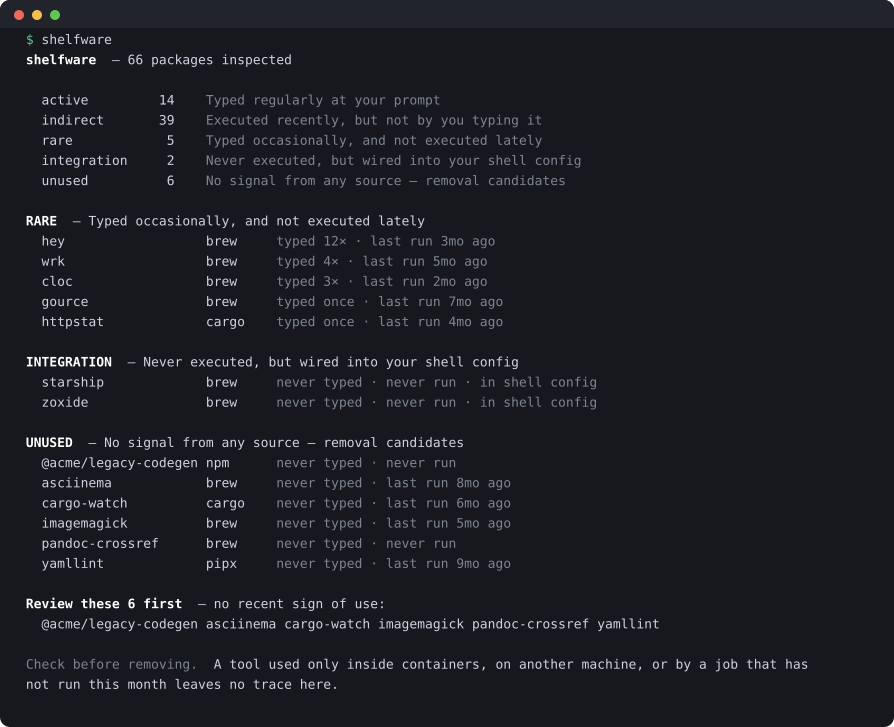
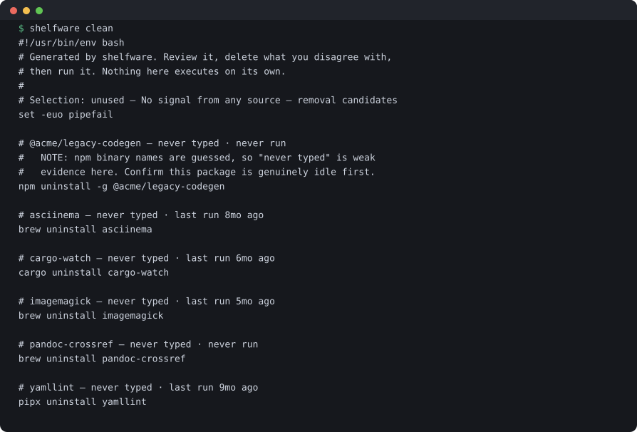

# shelfware

**Find the tools you installed and stopped using.**

[](https://crates.io/crates/shelfware)
[](https://github.com/Mathieu135/shelfware/actions/workflows/ci.yml)
[](LICENSE)

Every machine accumulates them: the CLI installed for one afternoon, the tool a
tutorial told you to add, the runtime left over from a project that shipped two
years ago. They take disk space, they slow down every upgrade, and you can no
longer remember which of them you still need.

`shelfware` cross-references what is installed on your machine against how you
actually use it, then tells you what earns its disk space and what does not. It
inspects Homebrew, cargo, uv, pipx, npm globals and `go install` binaries,
weighs four independent usage signals against each other, and prints the
evidence behind every verdict so you can argue with it.

It removes nothing. `shelfware clean` hands you a script to read.



<sub>An example machine. Publishing a real inventory would say more about its
owner than about the tool.</sub>

## Why not just count your history

Because counting is the easy half, and it is wrong on its own.

Grep your shell history for tools you never type and you will be told to
uninstall `ripgrep`, `fd` and `shellcheck` — three things you may use hundreds
of times a day. They just never reach your history, because a Makefile, a CI
job, a git hook or a coding agent runs them on your behalf. Meanwhile `bat`
looks dead because you spelled it `cat` ever since you aliased it, and `direnv`
looks dead because nobody types the name of a shell plugin.

On the machine this was written for, a naive count produced 13 removal
candidates. Six were real.

So `shelfware` reads four independent signals, each blind in a different way:

| Signal | Sees | Misses |
| --- | --- | --- |
| Shell history (Atuin, zsh, bash, fish) | what *you* ran, and how often | anything run by a script, hook, CI job or agent |
| Binary access times | that a binary ran at all, whoever launched it | how often, and by whom |
| Shell startup files | plugins and integrations loaded at login | anything configured elsewhere |
| Alias definitions | that `cat` is really `bat` | aliases defined outside your dotfiles |

A package is only reported as removable when *all four* stay silent.

## Verdicts

| Verdict | Meaning |
| --- | --- |
| `active` | Typed often enough to be beyond question |
| `indirect` | Executed recently, but not by you typing it — scripts, CI, agents |
| `rare` | Typed occasionally, and nothing has run it lately |
| `integration` | Never executed, but referenced by your shell config |
| `unused` | No signal from any source |

## Install

### A prebuilt binary — no toolchain required

Every release carries static Linux binaries and macOS ones, the latter unsigned.
Pick your platform and drop it on your `PATH`:

```sh
# Linux, x86_64 — statically linked, so any distribution will do
curl -fsSL https://github.com/Mathieu135/shelfware/releases/latest/download/shelfware-x86_64-unknown-linux-musl.tar.gz | tar xz
sudo install shelfware-*/shelfware /usr/local/bin/
```

```sh
# Linux, arm64
curl -fsSL https://github.com/Mathieu135/shelfware/releases/latest/download/shelfware-aarch64-unknown-linux-musl.tar.gz | tar xz
sudo install shelfware-*/shelfware /usr/local/bin/
```

```sh
# macOS, Apple silicon — swap aarch64 for x86_64 on an Intel Mac
curl -fsSL https://github.com/Mathieu135/shelfware/releases/latest/download/shelfware-aarch64-apple-darwin.tar.gz | tar xz
sudo install shelfware-*/shelfware /usr/local/bin/
```

`SHA256SUMS` is attached to the same release if you want to check the download.

### Homebrew

```sh
brew install Mathieu135/tap/shelfware
```

macOS and Linux both. The formula installs the release binary and its shell
completions, so no toolchain is involved.

### From crates.io

Requires Rust 1.88+ and a C compiler — SQLite is compiled in, so Atuin support
needs no system library.

```sh
# Linux — install a compiler first if you have none
sudo apt install build-essential      # or: dnf install gcc / pacman -S base-devel
cargo install shelfware
```

```sh
# macOS
xcode-select --install
cargo install shelfware
```

To follow `main` rather than a release, use
`cargo install --git https://github.com/Mathieu135/shelfware`.

## Use

```sh
shelfware                     # the report
shelfware clean               # a removal script to review
shelfware completions zsh     # shell completion
```

That is the whole interface. The one setting worth knowing is `--since`, which
decides how far back an execution still counts as "in use":

```sh
shelfware --since 6mo
```

`shelfware clean` prints a script rather than removing anything — you review
it, delete what you disagree with, and run it yourself. Some verdicts rest on
guessed binary names, so the final call stays yours.



Supported inventories: Homebrew (`brew leaves` only, so dependencies are never
suggested for removal), cargo, uv, pipx, npm globals, and `go install`
binaries. A package manager you do not have contributes nothing.

## Documentation

- [Usage](docs/usage.md) — installation, every option, configuration, JSON, cron
- [How it works](docs/how-it-works.md) — the signals, the verdict rules, the blind spots

`--help` carries the same material in the terminal; `-h` stays a single screen.

## How this was built

This was vibe coded: designed and written in a single pair-programming session
with Claude, from the first idea to the published repository. Better said up
front than inferred from the commit style.

What that means concretely:

- The classification rules were derived by measuring, not by guessing: on the
  machine this was written for, the naive version got 7 of 13 verdicts wrong,
  and every rule exists to fix one of those. The screenshots above are an
  example machine rather than that one, since a real report is an inventory of
  somebody's laptop.
- Design decisions were argued before being implemented. The comments in the
  source explain *why* a rule exists, which is usually "because the obvious
  implementation was wrong". `docs/how-it-works.md` is the long version.
- 36 tests, clippy clean at `-D warnings`, CI on Linux and macOS plus an MSRV
  check.
- It has been used by one person, on one operating system. **The Linux paths
  are untested in anger**, and the access-time signal behaves differently
  there — `noatime` mounts silence it entirely.

Review it the way you would review code from a stranger, because that is what
it is.

## Limitations

- **Access times can be disabled.** On Linux, `noatime` mounts give no signal
  at all. Check yours before trusting the `indirect` verdict.
- **Package upgrades touch files**, which can make a dead package look
  recently used. Conservative in the right direction.
- **Containers are invisible**, and access times are local even when your
  history syncs across machines.
- **npm binary names are guessed**, since npm does not report what a global
  package installs.
- **Casks and GUI apps are out of scope** — no command-line surface to measure.

Every row carries the evidence behind its verdict, so a wrong call is visible
rather than buried. The report is evidence for a decision, not the decision.

## License

MIT
